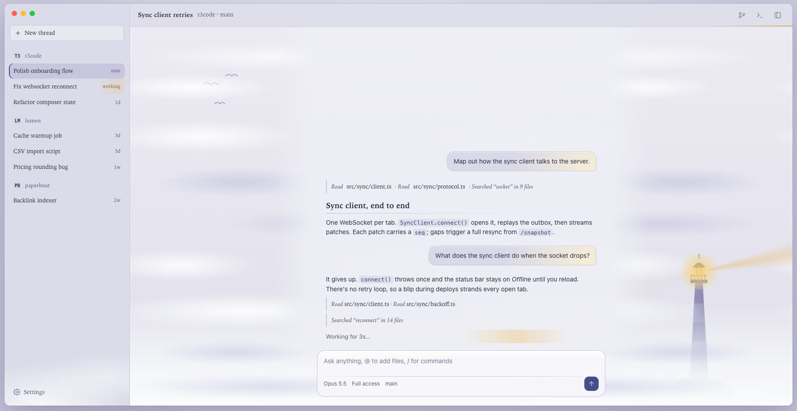

# Fogbank

**A coastal-fog theme for [T3 Code](https://t3.codes).** Pale grey-lilac paper, soft depth, and a lighthouse in the margin. Mist drifts barely at all while you read; when your agent works, the lamp wakes and its beam sweeps through the fog.

**[See it in motion →](https://joshsaintjacque.github.io/t3code-theme-fogbank/)**



## Install

**From the app**

1. Download [`fogbank.json`](fogbank.json), or copy its contents.
2. In T3 Code, open **Settings › Appearance › Add theme**.
3. Choose the file, or paste the JSON, and add it.

**From the terminal**

```sh
curl -fsSL -o fogbank.json https://joshsaintjacque.github.io/t3code-theme-fogbank/fogbank.json
~/.t3/bin/t3 theme set fogbank.json
```

Tested against the T3 Code 0.1.11 nightly theme API.

## What moves, and when

Every animation is tied to app state. At rest, only the fog drifts, slowly.

| | |
|---|---|
| **Fog bank** | A dense bank hugs the foot of the window and layered mist drifts across the margins at one slow, constant speed. It thickens while a turn runs, then eases back. |
| **Lighthouse beam** | A lighthouse stands in the right gutter. While a turn runs, its beam rotates through both gutters: a bright first sweep that settles to a soft turn on long runs. |
| **Turn complete** | When the turn ends the lamp blooms once and the beam dissolves into the mist (a transition, so it plays only when a turn finishes). |
| **Header glint** | A small amber glint crosses the header hairline during a turn. |
| **Lamp-bar** | On windows under 1240px a thin amber bar slides along the foot of the sidebar during a turn. |
| **Lamplight wash** | Busy threads and the live *Working…* row catch a slow amber wash. |
| **Composer focus** | The rim clears to indigo and a faint amber light rises beneath it. |
| **Narrow windows** | The lighthouse shrinks to fit the thinner gutter, and shrinks again down to 1180px, and below that a small lantern halo marks the working state. |

`prefers-reduced-motion` freezes all of it to a calm still.

## Palette

Grey-lilac is the paper, indigo is the ink, and amber belongs to the lamp.

| Role | Hex |
|---|---|
| Canvas | `#E8E7F0` |
| Sidebar | `#DDDBEA` |
| Message | `#DAD8EA` |
| Code | `#F4F3F9` |
| Text | `#2A2940` |
| Muted | `#55536F` |
| Border | `#C6C3D8` |
| Accent | `#474C8A` |
| Lamp (search match) | `#E3AC3E` |
| Update | `#2B7686` |
| Error | `#B0384A` |

## Make your own variant

`fogbank.json` is generated. Edit [`source/build.py`](source/build.py) and run it:

```sh
python3 source/build.py
python3 source/site.py   # regenerates index.html from the theme's palette
```

---

A community theme, not affiliated with or endorsed by T3 Code. [MIT licensed](LICENSE).
